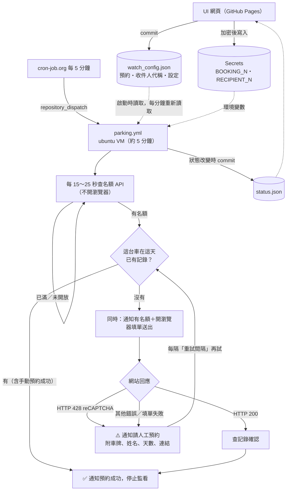

# 停車場預約監控

監看[桃園機場 P4 停車場等優惠預約平台](https://pcc.youparking.com.tw/parkingreserve/#/)，指定日期一有名額就同時通知並自動填單送出，再通知是否預約成功。沒搶到也會收到原因和預填資料，可以馬上手動完成。

預約資料、收件人和監控參數都在 **UI 網頁** 上調整：<https://k0341055.github.io/parking-agent/>

## UI 網頁（docs/index.html）

| 功能 | 說明 |
|---|---|
| 新增預約 | 停車場、進場日（起日）、天數、姓名、車牌、通知對象、是否自動送出。檢查規則和網站相同，會顯示使用區間和開放登記時間 |
| 預約清單 | 每筆的狀態：尚未開放、已滿、請人工預約（附原因）、已預約、已過期。可編輯、暫停、刪除、切換通知對象 |
| 快速預約 | 一鍵複製車牌／姓名／天數、開啟預約頁，以及「一鍵填單」書籤 |
| 收件人 | 新增 Email 和 LINE User ID，每筆預約可以通知不同的人 |
| 監控設定 | 開關、每次監看分鐘數、輪詢間隔、失敗重試間隔、提醒間隔 |
| 測試 | 立即檢查、測試填單（走到填好表單，不送出）、寄測試通知 |

**一鍵填單書籤：** 把按鈕拖到書籤列，在預約網站點一下，就會勾好須知、開到那天的表單、填好資料並框出「送出」，由你按下去。需要人工驗證時，驗證框就在同一個視窗。手機沒有書籤列，改用複製按鈕，或把書籤程式碼貼進書籤網址。

### 連線 GitHub（第一次使用）

沒有 token 時頁面是唯讀的。在頁面上點「GitHub 連線設定」，貼上 Fine-grained personal access token：

1. GitHub → Settings → Developer settings → [Fine-grained tokens](https://github.com/settings/personal-access-tokens/new) → Generate new token
2. Repository access：**Only select repositories** → `parking-agent`
3. Repository permissions：**Contents**、**Actions**、**Secrets** 都設為 **Read and write**

token 只存在該裝置瀏覽器的 localStorage，只會送給 GitHub API。

### 個資放在哪裡

這個 repo 和頁面都是公開的。

| 資料 | 位置 | 誰看得到 |
|---|---|---|
| 進場日、天數、停車場、代稱（`Booking_N`、`Recipient_N`）、預約狀態 | `watch_config.json`、`status.json` | **任何人** |
| 姓名、車牌 | GitHub Secret `BOOKING_N` | 讀不回來，只有 Actions 用得到 |
| Email、LINE User ID | GitHub Secret `RECIPIENT_N` | 讀不回來，只有 Actions 用得到 |
| 姓名、車牌的裝置副本 | 瀏覽器 localStorage、一鍵填單書籤 | 只有那台裝置 |

Secret 在瀏覽器用 repo 的公鑰加密（libsodium sealed box）才送給 GitHub API。Actions log 也是公開的，所以程式只記代稱，網站回應裡的車牌和姓名會先遮掉，也不再上傳截圖。

## 架構



## 通知與狀態

| 情況 | 行為 | 通知 |
|---|---|---|
| 日期還沒開放、已滿 | 繼續監看 | ❌ |
| 有名額 | 同時送通知和開始填單（不會互相拖慢） | ✅ 有名額，附手動預約資料 |
| 自動預約成功 | 查記錄確認，停止監看 | ✅ 成功 |
| 網站要求 reCAPTCHA 驗證 | 程式不處理驗證，之後每隔重試間隔再試一次 | ✅ 請人工預約 |
| 這台車已有其他日期的登記 | 網站規定要先取消舊登記才能重新申請；程式不會幫你取消 | ✅ 請人工預約，附取消連結 |
| 填單失敗（網站改版、逾時） | 之後每隔重試間隔再試一次 | ✅ 請人工預約 |
| 送出前名額被搶走 | 繼續監看，下次有名額立刻再通知 | ✅ 名額被搶走 |
| 手動預約成功 | 下次檢查查到記錄就停止監看 | ✅ 成功 |
| 持續有名額但一直沒成功 | 每隔「提醒間隔」才再通知一次，不會一直響 | ✅ |
| 名額 API 連續查不到 | 可能是網站維護或改版，6 小時最多通知一次 | ✅ 查詢失敗 |
| 過了登記期限（進場前 2 天） | 停止監看 | ✅ 已過期 |

LINE 通知多一張按鈕卡片，可以開啟預約頁、一鍵複製車牌／姓名／天數。

**午夜開放：** 網站每天 00:00 開放第 20 天後的日期（例：01/01 進場，12/12 開放），限額 100 名，額滿後有人取消才會釋出。目標日期當晚開放時，監控會撐過午夜（23:55～00:03），並在 00:00 前後改成每 3 秒查一次。

**reCAPTCHA：** 網站送出時用 reCAPTCHA v3 評分，分數不夠就回 HTTP 428 要求人工驗證。GitHub Actions 的機房 IP 可能比較容易被要求驗證，這時就走人工預約。程式不會嘗試破解驗證。如果一直被擋，可以在自己電腦上開視窗執行（見「本機執行」）。

## 部署

### 1. GitHub Secrets

| Secret | 說明 |
|---|---|
| `GMAIL_SENDER`、`GMAIL_PASSWORD` | 寄件 Gmail 與[應用程式密碼](https://myaccount.google.com/apppasswords) |
| `LINE_CHANNEL_ACCESS_TOKEN` | [LINE Messaging API](https://developers.line.biz/console/) 的 Channel access token（免費方案每月 200 則） |
| `BOOKING_N`、`RECIPIENT_N` | 由 UI 寫入，不用手動建立，上限各 10 筆 |
| `GMAIL_RECIPIENTS`、`LINE_USER_ID` | 舊設定：沒有 `RECIPIENT_N` 時，`Recipient_N` 用 `GMAIL_RECIPIENTS` 第 N 個，`Recipient_1` 另外用 `LINE_USER_ID` |

舊的 `BOOKER_NAME`、`BOOKER_PLATE` 已經不用，可以刪除。

### 2. GitHub Pages

Settings → Pages → Source：**Deploy from a branch**，Branch：`main`、資料夾 `/docs`。

### 3. 啟用 workflow

Actions → Parking Availability Check → Enable workflow（UI 頁面也有啟用按鈕）。

### 4. cron-job.org（讓排程準時）

GitHub Actions 的 cron 常延遲 5～30 分鐘，所以由 [cron-job.org](https://cron-job.org) 主動觸發：

| 欄位 | 值 |
|---|---|
| **URL** | `https://api.github.com/repos/k0341055/parking-agent/dispatches` |
| **排程** | `*/5 * * * *`（時區 `Asia/Taipei`） |
| **Method** | `POST` |
| **Body** | `{"event_type": "trigger"}` |
| **Headers** | `Authorization: Bearer <PAT>`、`Accept: application/vnd.github+json`、`Content-Type: application/json` |

PAT 建議另外建立一支、只給這個 repo 的 **Contents: Read and write**（`repository_dispatch` 需要的權限）。workflow 設有 `concurrency`，同時間只會跑一個 run，不會重複送出。

## 本機執行

```bash
pip install -r requirements.txt
playwright install chromium
cp parking_book/.env.example .env    # 填入真實值

python parking_book/parking_agent_v2.py              # 監看
HEADLESS=0 python parking_book/parking_agent_v2.py   # 開視窗監看
DRY_RUN=1 python parking_book/parking_agent_v2.py    # 測試填單，不送出
SEND_TEST=1 python parking_book/parking_agent_v2.py  # 寄測試通知
```

## 測試

```bash
pip install pynacl
python -m unittest tests.test_agent   # 狀態與通知邏輯，不連網
python -m unittest tests.test_e2e     # 瀏覽器完整流程
python -m unittest tests.test_ui      # UI 網頁（GitHub API 是假的）
```

`test_e2e`、`test_ui` 用網站真正的前端 JS（第一次從官網下載後快取到 `tests/.site_cache/`），搭配本機假 API，所以可以放心測送出。網站改版導致流程壞掉時，這些測試會失敗。

要驗證真實網站，用 UI 的「測試填單」：會走到填好表單但不送出，目標停車場沒名額時改用流程相同的日月亭。

## 檔案結構

```
.
├── .github/workflows/parking.yml   # 排程與執行
├── docs/index.html                 # UI 網頁
├── docs/vendor/nacl-fast.min.js    # 加密 Secret 用的 tweetnacl-js 1.0.3
├── parking_book/
│   ├── parking_agent_v2.py         # 主程式
│   ├── parking_agent.py、.ipynb    # 舊版，已不使用
│   └── .env.example
├── tests/                          # 測試與模擬網站
├── watch_config.json               # UI 寫入的設定
└── status.json                     # 程式寫入的狀態
```
